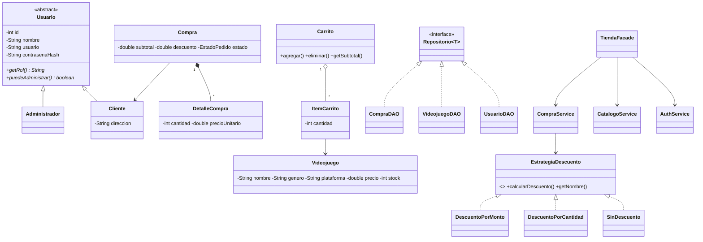

# Documentación del proyecto — GameStore

## 1. Descripción

GameStore es una tienda en línea de **videojuegos físicos**. Los productos se envían a la dirección del cliente, por eso
el sistema maneja **stock** (unidades en inventario), **dirección de envío** y **estado del pedido** (PENDIENTE / ENVIADO).

## 2. Roles

| Rol | Puede hacer |
|---|---|
| Cliente | Registrarse, iniciar sesión, buscar en el catálogo, usar el carrito, confirmar compra con dirección de envío, ver sus pedidos |
| Administrador | Iniciar sesión, agregar / modificar / eliminar videojuegos y su stock, ver todos los pedidos y marcarlos como enviados |

## 3. Reglas del negocio

- No se puede agregar al carrito más unidades que el stock disponible.
- Al confirmar la compra, el stock se descuenta; si falla algo, no se guarda nada (transacción).
- Descuentos (se aplica el mayor, no se suman): **10 %** al comprar 3 o más unidades; **5 %** si el subtotal es $150 o más.
- No se puede eliminar un videojuego que ya tiene compras asociadas.
- Las contraseñas se guardan como hash SHA-256, nunca en texto plano.

## 4. Diagrama de clases (simplificado)

## 5. Arquitectura por capas

`vista` (Swing) → `fachada` (TiendaFacade) → `servicio` (reglas) → `dao` (SQL) → `bd` (conexión SQLite)

## 6. Modelo de datos

| Tabla | Campos principales |
|---|---|
| `usuario` | id, nombre, usuario (único), contrasena (hash), rol (ADMIN/CLIENTE), direccion |
| `videojuego` | id, nombre, genero, plataforma, precio, stock |
| `compra` | id, id_cliente → usuario, fecha, direccion, subtotal, descuento, total, estado |
| `detalle_compra` | id, id_compra → compra, id_videojuego → videojuego, nombre, cantidad, precio_unitario |

El script completo está en `src/main/resources/schema.sql`.
